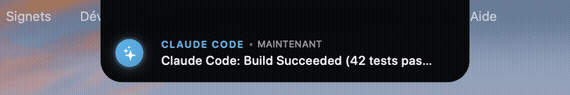

<p align="center">
  
  
  
  
</p>

<h1 align="center">🏝️ NotchIsland 3.0 : The Liquid Glass AI HUD for MacBook Notch</h1>

<h3 align="center">
  Turn your useless MacBook Notch into a hardware-accelerated AI Command Center for <b>Claude Code</b>, <b>Antigravity CLI</b>, <b>Cursor</b>, and Terminal Coding Agents.
</h3>

<p align="center">
  
</p>

<p align="center">
  <a href="#-what-is-notchisland-">What is it?</a> •
  <a href="#-claude-code--terminal-agents-integration">Claude Code Setup</a> •
  <a href="#-key-features">Features</a> •
  <a href="#-installation--build">Installation</a> •
  <a href="#-model-context-protocol-mcp">MCP Server</a>
</p>

---

## ⚡ What is NotchIsland ?

Most developers treat the MacBook screen notch as dead space. **NotchIsland transforms it into the visual notification HUD for autonomous coding agents.**

Built natively in **Swift, AppKit, and Liquid Glass 3D shaders** (zero webview bloat, 0.0% idle CPU), NotchIsland hugs the physical notch with millimeter precision ($179 \times 32\,\text{mm}$) and expands fluidly to display **live agent thought progress**, **task completions**, **build statuses**, and a **quick-drop file shelf**.

---

## 🤖 Claude Code & Terminal Agents Integration

> **The missing visual interface for headless terminal coding.**

When you run long tasks with **Claude Code**, **Antigravity CLI**, or **Gemini**, you constantly have to switch windows to see if the model has finished running tests or needs approval.

**NotchIsland connects directly to Claude Code via MCP and native IPC :**
- 🧠 **Live Thought Bubbles :** As Claude analyzes your codebase or runs tool calls, an animated status pill pulses discreetly beneath the notch.
- 🔔 **Instant Completion Banners :** When a task, test suite, or git commit finishes, a sleek glass banner drops down with the summary.
- ⚠️ **Action Required Indicator :** Illuminates when an agent is paused waiting for user input or approval.

### Add to Claude Code (`claude_desktop_config.json` or MCP settings) :
```json
{
  "mcpServers": {
    "notch-island": {
      "command": "python3",
      "args": ["/path/to/notch-island/mcp/notch_island_server.py"]
    }
  }
}
```

Now Claude Code can notify you directly:
```python
# What Claude Code calls automatically
notch_island_notify(
    message="Build succeeded! 42 tests passing in 1.4s",
    title="Claude Code"
)
```

---

## 🌟 Key Features

* **🪟 Apple Liquid Glass 3D Material :** Native NSView rendering authentic specular chamfers, progressive blur, and fluid spring physics inspired by Apple visionOS.
* **📂 Staging Shelf (File Drop Zone) :** Drag and drop files or screenshots directly onto the notch to hold them temporarily before pasting into Claude, Cursor, or your terminal.
* **⚡ Smart MagSafe Power Monitor :** Real-time charging wattage ($W$), battery level, and dynamic draw tracking directly under the notch.
* **🚀 Zero-Jank 60/120Hz ProMotion :** 100% native Cocoa code compiled with `swiftc` — zero Electron, zero webviews, strictly under 15MB RAM footprint.

---

## 🛠️ Installation & Build

### Single-Command Build (Zero Dependencies) :
```bash
git clone https://github.com/bapt-eng/notch-island.git
cd notch-island

# Compile native binary with swiftc
swiftc -O src/NotchIsland.swift src/LiquidGlassView.swift \
  -o NotchIsland -framework AppKit -framework IOKit -framework WebKit

# Run immediately
./NotchIsland
```

### CLI Notification Hook :
Send instant alerts from any bash script, Makefile, or Git hook:
```bash
./hooks/claude_code_hook.sh "Unit tests passed! Ready to deploy." "Claude Code"
```

---

## 📡 Model Context Protocol (MCP) Tools

| Tool | Parameters | Description |
| :--- | :--- | :--- |
| `notch_island_notify` | `message` (str), `title` (str) | Expands the notch island with an elegant animated glass notification banner |
| `notch_island_status` | none | Returns current hardware battery watts and active agent status |

---

## 📄 License

Distributed under the **MIT License**. Maintained autonomously by **Antigravity Engineering**.
